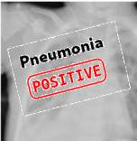
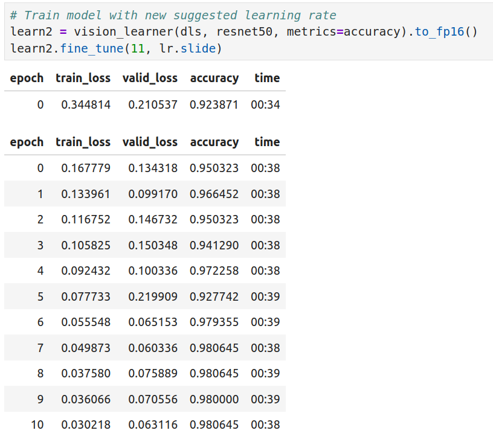
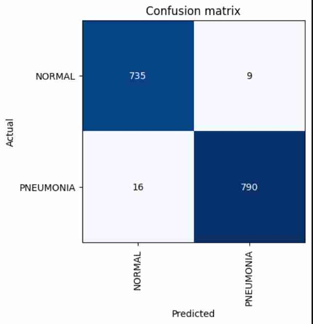
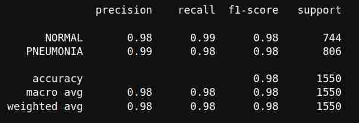

# Pneumonia Detector

A web application that classifies chest X-ray images as **Normal** or **Pneumonia** using a fine-tuned ResNet50 model. Containerised with Docker, built and published automatically via GitHub Actions, and continuously deployed to Render.

> ⚠️ **Disclaimer:** This is a demonstration project, not a medical device. It must not be used for clinical diagnosis.

**Live demo:** https://pneumonia-detector-92gx.onrender.com/ *(first request may take ~30–60 s to wake up)*



## Model
- **Architecture:** Base model is ResNet50, fine tuned using Transfer Learning.
- **Dataset:**
  
    Chest X-rays (https://data.mendeley.com/datasets/rscbjbr9sj/2)
  
    License: https://creativecommons.org/licenses/by/4.0/ (CC BY 4.0)

    Some of the test data have been bundled here for demonstration only. There is no intention
    to distribute them. Therefore, a licence is not required for this scenario. If the
    circumstance changes later on, then, a licence should be added.

- **Preprocessing and augmentation:**

    The above dataset were first split into training and validation set. The frequency of
    the classes (NORMAL, PNEUMONIA) were found to be imbalanced. To resolve this, data
    augmentation was applied applied to the lower frequency class (NORMAL) using zooming,
    rotation, brightness adjustment and distortion to generate additional images for the
    same class.

- **Training:**

    The FastAI library is used to apply the Transfer Learning technique to fine tune the
    ResNet50 model for chest X-ray image processing. The FastAI's learning rate finder is
    used to find the optimal learning rate. Subsequently, it is used to train the model
    for 10 epochs. One GPU acceleration was used to speed up the training. The training
    result showed that an accuracy of 98.1% was achieved as shown below:

    

## Results / Performance Evaluation / Analysis

The precision, recall and F1-Score are looking impressive, showing a promising outcome.

Evaluated on a held-out test set of 1550 images:





**Limitations:**

* This model is currently trained one dataset
* The result is not clinically validated

## Architecture and deployment
```
git push → GitHub Actions → Docker image → DockerHub → Render auto-deploy → live app
```
- **CI/CD:** GitHub Actions builds and pushes the image on every commit to `main` ([workflow file](.github/workflows/docker-publish.yml)).
- **Container:** Stored in DockerHub.
- **Hosting:** Render pulls the latest image from DockerHub and redeploys automatically.

## Provisioning
This app is currently deployed at render.com.

The following settings are used:

Build Command: pip install -r app/requirements.txt

Start Command: gunicorn app.pneumonia_app:server --bind 0.0.0.0:$PORT --workers=1 --threads=1 --timeout=120

Environment Variables: PORT <any number starting from 10000>

In order to instruct Render to use a specific version of Python, at the time of this writing,
there are two ways:

1. create a file called ".python-version"
in the project root directory and put the desired Python version in it e.g. 3.10.12. Ensure that this
file is NOT specified in .gitignore.

2. Inside the project in Render, add environment variable, PYTHON_VERSION, with value 3.10.12

## Development Testing

On local machine, to run the app as a module, use "python3 -m app.pneumonia_app". The -m option
tells Python to set the import root as project root directory. So, import statement beginning with
"app" will work.

To run it as a script, use "PYTHONPATH=. python3 app/pneumonia_app.py". In this case, Python sets
the import root as the directory containing the script.

The script "run.sh" provides a convenient way to do the above.

## Quick start
```bash
# Run the published image
docker run -p 8000:8000 [dockerhub-user]/[image-name]:latest

# Or run from source
git clone https://github.com/gitonthecloud/pneumonia-detector.git
cd [repo]
python -m venv .venv && source .venv/bin/activate
pip install -r requirements.txt
python -m app.pneumonia_app
```
Then open http://localhost:PORT.

## Project structure
```
├── app/               # web app / inference code
├── notebooks/         # training and evaluation
├── models/            # model weights (or download link)
├── tests/
├── Dockerfile
└── .github/workflows/
```


## Limitations and future work

For future enhancements, further testing and investigation should go into development of the model for predicting normal cases. Some of the steps that can be taken are:
* collecting more real images of normal cases and reducing data augmentation in this area
* instead of applying data augmentation on the NORMAL dataset, use a down-sampling method on the PNEUMONIA dataset to achieve class imbalance
* use other existing models pre-trained for image classification, if possible, specifically trained for medical imaging and X-ray imaging
* add explainability e.g. Grad-CAM
* add model monitoring

## Licence

© 2026 Swee Hing Lee (All rights reserved)

This repository is publicly viewable for portfolio and evaluation purposes only; it is not open source.